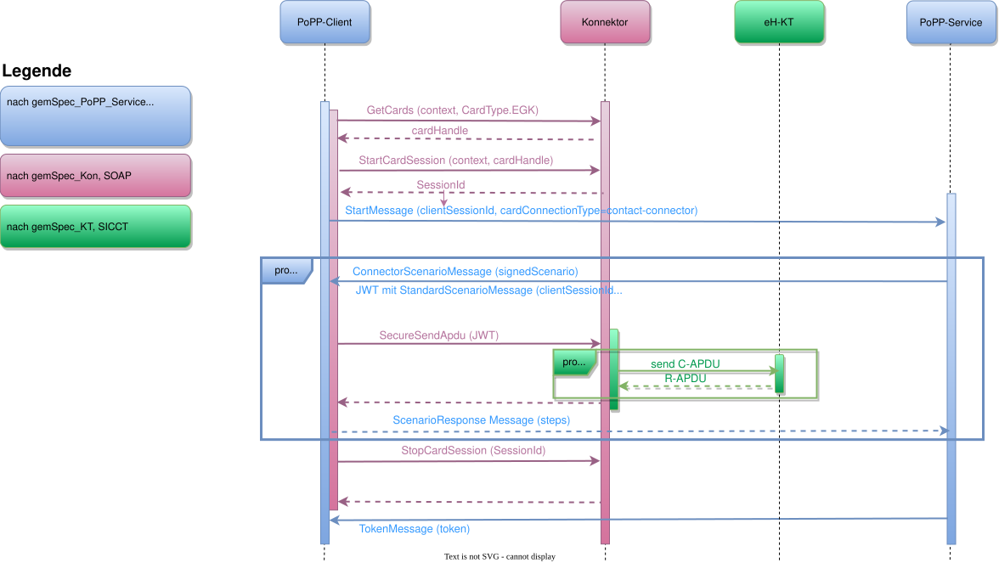
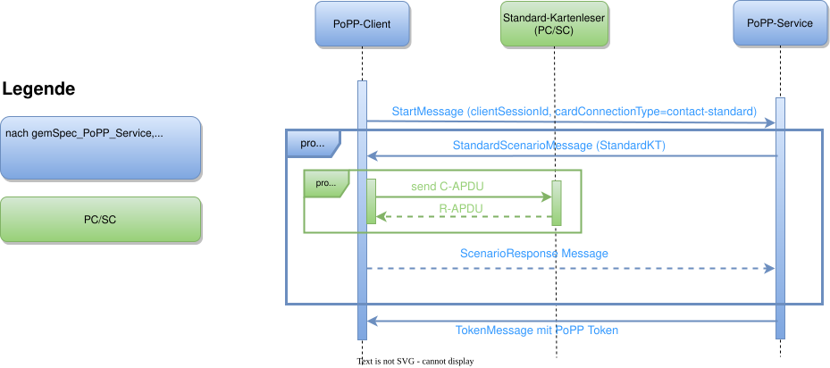
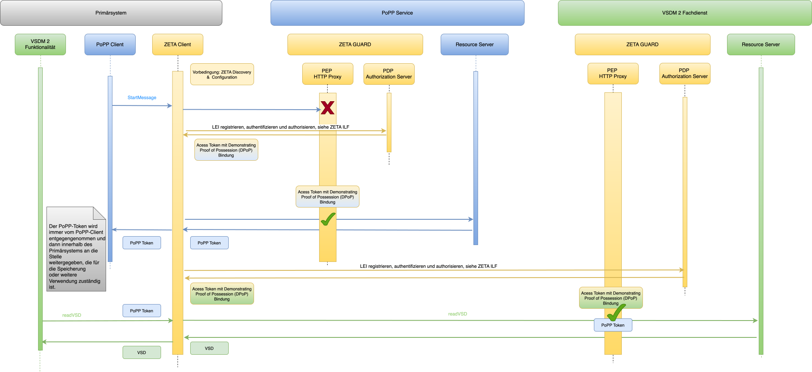

 

**Inhaltsverzeichnis**
<!-- TOC -->

* [Funktionsmerkmale des PoPP-Client](#funktionsmerkmale-des-popp-client)
   * [PoPP-Token Generierung](#popp-token-generierung)
      * [PoPP-Token mit Konnektor und eHealth Kartenterminal](#popp-token-mit-konnektor-und-ehealth-kartenterminal)
      * [PoPP-Token mit Standard-Kartenleser](#popp-token-mit-standard-kartenleser)
   * [Verwendung des ZETA Clients](#verwendung-des-zeta-clients)
   * [Überblick von ZETA, PoPP und VSDM 2.0](#überblick-von-zeta-popp-und-vsdm-20)
      * [Voraussetzungen](#voraussetzungen)
      * [Ablauf bei PoPP](#ablauf-bei-popp)
      * [Ablauf bei VSDM 2.0](#ablauf-bei-vsdm-20)
      * [Zusammenfassung](#zusammenfassung)
   * [PoPP Beispielimplementierung](#popp-beispielimplementierung)

<!-- TOC -->

# Funktionsmerkmale des PoPP-Client

## PoPP-Token Generierung

In den folgenden Darstellungen wird die PoPP-Token Generierung zwischen
PoPP-Client und PoPP-Service
visualisiert. Unterschiede ergeben sich, ob die eGK mit Konnektor und eHealth
Kartenterminal bzw.
mit Standard-Kartenleser verwendet wird.

Die Kommunikation mit dem ZETA Client wird in diesem Dokument im Überblick
betrachtet.

Implementierungsdetails finden sich im Abschnitt
zur [eGK](../docs/eGK/00_uebersicht.md).

### PoPP-Token mit Konnektor und eHealth Kartenterminal

### PoPP-Token mit Standard-Kartenleser

## Verwendung des ZETA Clients

Alles rund um die Abläufe und die Nutzung des ZETA Clients finden Sie in
der [ZETA Dokumentation](https://github.com/gematik/zeta-sdk).

_Hinweis:_ ZETA wird in diesem Dokument nur überblicksmäßig behandelt.

## Überblick von ZETA, PoPP und VSDM 2.0

Die folgende Übersicht zeigt die Verknüpfung zwischen ZETA und PoPP sowie einen
Ausblick auf die Integration von VSDM 2.0. Sie bietet eine grundlegende
Erklärung, ohne alle Details von ZETA oder die vollständigen Abläufe von PoPP
darzustellen. Wichtige Informationen zu ZETA finden sich
im [ZETA Implementierungsleitfaden für Primärsysteme][].

Die Darstellung beschreibt, wie die drei Clients im Primärsystem miteinander
interagieren und wie die Kommunikation über ZETA mit den entsprechenden
Fachdiensten erfolgt.

### Voraussetzungen

Bevor die Abläufe starten können, muss die **ZETA Discovery und Konfiguration**
erfolgreich abgeschlossen sein. (Weitere Informationen dazu finden
Sie [hier](https://gematik.github.io/zeta/docs/api/v1/#konfiguration-und-discovery)).

### Ablauf bei PoPP

1. **Start der Kommunikation**:  
   Der PoPP-Client sendet eine **StartMessage** über ZETA an den PoPP-Service.
   Falls die LEI zu diesem Zeitpunkt noch nicht registriert, authentifiziert und
   autorisiert ist, blockiert der **ZETA PEP HTTP Proxy** im **ZETA Guard** des
   PoPP-Services die Anfrage. Dies wird in der Darstellung durch eine blockierte
   Nachricht vom HTTP-Proxy verdeutlicht.

2. **Registrierung, Authentifizierung und Autorisierung**:  
   Der ZETA-Client im Primärsystem übernimmt die Anmeldung der LEI,
   ihre [Registrierung][] sowie die [Authentifizierung und Autorisierung][]
   gegenüber dem PoPP-Service.

3. **Freigabe der StartMessage**:  
   Nach erfolgreicher Registrierung, Authentifizierung und Autorisierung wird
   die **StartMessage** zugelassen. Der weitere Ablauf zwischen PoPP-Client und
   PoPP-Service erfolgt wie oben im
   Kapitel [PoPP-Token Generierung](#popp-token-generierung) beschrieben.

4. **PoPP-Token-Verarbeitung**:  
   Der PoPP-Token wird vom PoPP-Client entgegengenommen und innerhalb des
   Primärsystems an die zuständige Stelle zur Speicherung oder Weiterverwendung
   weitergeleitet.

### Ablauf bei VSDM 2.0

1. **Kommunikation mit dem VSDM 2.0-Fachdienst**:  
   Der ZETA-Client sorgt für die Anmeldung und Registrierung der LEI sowie deren
   Authentifizierung und Autorisierung gegenüber dem **VSDM 2.0-Fachdienst**.

2. **Nutzung des PoPP-Tokens**:  
   Der PoPP-Token wird der **readVSD-Anfrage** hinzugefügt, um dem Primärsystem
   Zugriff auf den Ressource-Server des VSDM 2.0-Fachdienstes zu ermöglichen.

3. **Prüfung des PoPP-Tokens**:  
   Der **ZETA Guard** überprüft im Fall von VSDM 2.0 den PoPP-Token gemäß den
   Vorgaben (siehe [Prüfung des PoPP-Tokens][]).

### Zusammenfassung

Die Darstellung zeigt, wie die Komponenten ZETA, PoPP und VSDM 2.0
zusammenarbeiten. ZETA übernimmt dabei zentrale Funktionen wie die Anmeldung,
Registrierung, Authentifizierung und Autorisierung. Die Kommunikation zwischen
den Systemen wird durch spezifische Sicherheitsmechanismen wie den ZETA Guard
und den PoPP-Token geschützt und gesteuert.

## PoPP Beispielimplementierung

Mit der [gematik PoPP Beispielimplementierung][] bekommen Sie einen schnellen
und unkomplizierten Einstieg ins Thema.
Sie sehen direkt im Quellcode an einem praktischen Beispiel wie Sie

- die Schnittstelle zwischen PoPP-Client und PoPP-Service,
- die Anbindung eines Standard-Kartenlesers und
- die Verwendung der neuen Konnektormethoden implementieren könnten.

Das Beste: Sie können direkt ausprobieren, eigene Anpassungen vornehmen und so
besser verstehen, wie alles funktioniert.

[Authentifizierung und Autorisierung]:https://gematik.github.io/zeta/docs/api/v1/#authentifizierung-und-autorisierung

[Prüfung des PoPP-Tokens]:https://gemspec.gematik.de/docs/gemSpec/gemSpec_ZETA/latest/#A_26477

[Registrierung]:https://gematik.github.io/zeta/docs/api/v1/#client-registrierung

[ZETA Dokumentation]: https://github.com/gematik/zeta/blob/main/docs/api/v1/index.md

[ZETA Implementierungsleitfaden für Primärsysteme]:https://gematik.github.io/zeta/docs/api/v1/

[gematik PoPP Beispielimplementierung]: https://github.com/gematik/popp-sample-code
